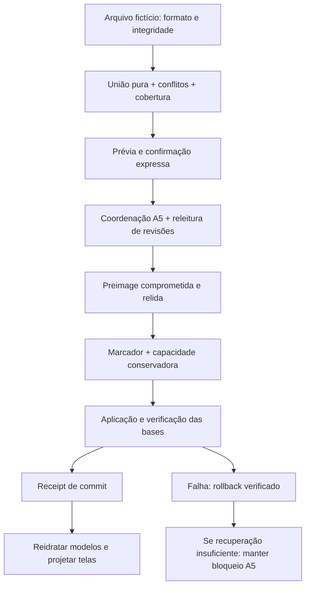

# C. Plano técnico de correção — proposta, sem implementação

Todas as alterações dependem da auditoria A5 e de autorização posterior. A proposta não é código aprovado nem especificação final do formato.

## D-A4-01 — Escrita direta da mesclagem sem proteção global recuperável

**Escopo e referências:** A4 com dependência de A5; P0-3; AJ-18; B-102 (relação, não reprovação nova).

**Código DEV.4:** linhas 856–907, especialmente 864, 885–900. **Módulos:** ma53-merge-file; ma-care-v2; ma-ledger-v1; taxas.

**Causa:** A mesclagem clona db em memória, grava três chaves diretamente, não usa MA5.lock, journal ou comparação clínica. O snapshot care usa db, não o oldCare recém-lido. Rollback captura exceção própria sem confirmar o resultado.

**Proposta:** Planejar um comando de merge com prévia, revisão esperada, exclusividade, preimage de todas as bases afetáveis, marcador/rollback A5 e verificação de bytes; calcular a união a partir do estado persistido validado, nunca do cache antigo.

**Dependências:** Auditoria Claude sobre journal, reserva, recuperação e coordenação A5; autorização de implementação.

**Aceitação independente:** T-A4-02,04,05,06,07,08, na matriz D; não considerar aprovado nesta etapa.

## D-A4-02 — Modelos e telas não atualizados após merge

**Escopo e referências:** A4 histórico; P0-3; A1-45; B-120; B-121; AJ-8 (referência textual).

**Código DEV.4:** linhas 590–609, 670–682, 726–730, 890–905. **Módulos:** Livro, contabilidade, pesquisas, evoluções, indicadores e caches clínicos.

**Causa:** O handler termina com db=next e renderAccount/storageStatus. Não atualiza rows/ma62LedgerRaw, ma5CareExpected ou todas as projeções. O trecho de merge é byte a byte igual ao da DEV.3.

**Proposta:** Adaptadores reidratam modelos somente após commit verificado e publicam evento de atualização. Atualizar token esperado junto ao modelo confirmado; conservar rascunhos, seleção e filtros.

**Dependências:** D-A4-01 antes de ativar refresh; mapa de dependências de views.

**Aceitação independente:** T-A4-01,03,09,10,30, na matriz D; não considerar aprovado nesta etapa.

## D-A4-03 — Conflitos de identidade e duplicidades tratados apenas por IDs

**Escopo e referências:** A4; decisão funcional; P0-3 (família); sem ID histórico específico para esta ampliação.

**Código DEV.4:** linhas 863–879. **Módulos:** Pacientes, pagamentos, evoluções e livro.

**Causa:** Sets por IDs ignoram conteúdo divergente no mesmo ID. IDs diferentes com conteúdo equivalente entram novamente. Não há mapa de origem de IDs nem prévia de conflito campo a campo. A regra atual preserva explicitamente IDs existentes.

**Proposta:** Enumerar iguais, novos, conflitantes e possíveis duplicados; preservar IDs tipados/valores; recusar conflitos de referência não resolvidos; decisão expressa por entidade, sem deduplicação automática por nome, valor ou CPF.

**Dependências:** Política de identidade, fontes e precedência; nenhuma mudança silenciosa de IDs.

**Aceitação independente:** T-A4-11,12,13,14,15,16, na matriz D; não considerar aprovado nesta etapa.

## D-A4-04 — Leitor de merge divergente dos formatos/validações A5

**Escopo e referências:** A4 com contrato A5; B-119 (restauração, escopo distinto); B-120 (merge legado).

**Código DEV.4:** linhas 860–877, 893; A5 engine inspectText/describe. **Módulos:** Merge v2/v3, legado financeiro e taxas.

**Causa:** Aceita format v2 sem exigir backup.version; rejeita format v3 exportado pela própria DEV.4; exige ID textual no incomingLedger, mas não valida todos os demais campos das linhas. Taxas podem entrar sem validador se a base atual estiver ausente.

**Proposta:** Especificar uma política de merge versionada; reutilizar leitura/validação de A5 sem confundir restauração e união. Arquivo parcial mantém módulos ausentes; ilegíveis não entram na base ativa; originais permanecem em arquivo/journal/quarentena conforme decisão.

**Dependências:** Auditoria da validação v3 e legado; decidir se v3 integra o primeiro lote ou é recusado explicitamente até lote posterior.

**Aceitação independente:** T-A4-17,18,19,20,21, na matriz D; não considerar aprovado nesta etapa.

## D-A4-05 — Correspondência Codental e preservação manual dependem de heurísticas

**Escopo e referências:** A4; integração/proveniência transversal; P0-4 (algoritmo, não a política); sem ID histórico específico para este risco.

**Código DEV.4:** linhas 684–689, 909–910. **Módulos:** Cadastro e sincronização Codental.

**Causa:** Busca ID Codental, depois CPF e depois nome normalizado. Preserva campos não vazios quando source é literalmente Cadastro no aplicativo; ambiguidades são separadas. Não há proveniência por campo nem namespace de origem.

**Proposta:** Prévia por correspondência e campo; ambiguidades ficam pendentes; não unir por nome sozinho por padrão; preservar política de não apagar com vazio e definir proveniência granular sem migrar automaticamente dados antigos.

**Dependências:** Decisão de identidade/proveniência e contrato da alimentação embutida; não reinjetar seeds após restore.

**Aceitação independente:** T-A4-22,23,24,25, na matriz D; não considerar aprovado nesta etapa.

## D-A4-06 — Concorrência e atualização entre abas são incompletas

**Escopo e referências:** Transversal relacionado a A4; P1-3; A1-40/41/42/43; C-46 (regressões do livro).

**Código DEV.4:** linhas 419, 595–603, 727–730, 1370, 1671/1679, 1730–1736, 2671; A5 guard/singleTab. **Módulos:** Todas as bases persistidas, especialmente taxas/checklist56.

**Causa:** Não há listener storage nem BroadcastChannel. Livro usa MA5.lock; clínico/Academia/Sanitária fazem comparação de texto, mas não usam o mutex para tornar comparação+escrita atômicas entre páginas. Taxas/checklist56 escrevem sem comparação equivalente.

**Proposta:** Todos os escritores cooperantes usam a mesma disciplina de lock e revisão. Notificação de invalidação é complementar, nunca autoridade. Releitura em foco/visibilidade e antes de gravar; abas com rascunho mostram conflito sem substituir formulário.

**Dependências:** Contrato A5 de Web Locks/file://; não prometer proteção contra DEV.3 ou console.

**Aceitação independente:** T-A4-26,27,28,29,31,32, na matriz D; não considerar aprovado nesta etapa.

## D-A4-07 — Estado em memória alterado mesmo quando o salvamento falha

**Escopo e referências:** Transversal UI/persistência; A1-56/57 (regressões já protegidas no livro); P1-3 (relação).

**Código DEV.4:** linhas 418–421, 1391/1398–1400, 1422, 2696–2698. **Módulos:** Simulador, Academia, materiais, POPs, Sanitária.

**Causa:** Taxas, listas da Academia e mapas sanitários são alterados antes de salvar. Alguns handlers não restauram o objeto após false; taxa recalcula mesmo no catch. Exportações específicas leem data/state em memória.

**Proposta:** Modelo confirmado imutável + rascunho separado; commit em dois estágios, render de sucesso só após confirmação. Preservar o texto não salvo de forma explícita, sem apresentar como registro persistido ou backup oficial.

**Dependências:** Contrato de retorno de todos os adaptadores; política para rascunhos ainda não persistidos.

**Aceitação independente:** T-A4-33,34,35,36, na matriz D; não considerar aprovado nesta etapa.

## D-A4-08 — Submódulos ma58/59/60 não reidratados pela importação da Academia

**Escopo e referências:** A4 de projeções; módulo Academia/Laboratório; Sem ID histórico específico; BKP-08 é outro problema.

**Código DEV.4:** linhas 1442–1455; 1920/1924; 2162/2168; 2351/2353. **Módulos:** ma-academy-v55; estúdio, workshop Exocad e bancada.

**Causa:** Importação troca data do módulo pai. Os filhos carregam state na inicialização e seus wrappers escrevem de volta subcampos de data. Não há chamada de reload desses estados ao importar.

**Proposta:** Importação notifica todos os filhos; adaptadores load/render explícitos e uma revisão compartilhada da base. Invalidar ações de estado antigo até reidratação, preservando rascunhos. Evitar recriar scripts/listeners para atualizar.

**Dependências:** A5 inclui os três subcampos na mesma chave; manter indivisibilidade da base e validação v1.

**Aceitação independente:** T-A4-37,38,39, na matriz D; não considerar aprovado nesta etapa.

## D-A4-09 — Atualizações de filtros/mês e navegação são dispersas

**Escopo e referências:** A4 visual/fluxo; A1-45 (projeções); sem ID histórico específico para mês/navegação.

**Código DEV.4:** linhas 613/733/1372, 744–775, 851, 903–905, 1682–1696, 1740–1762. **Módulos:** 18 telas, mês contábil, pesquisa, paciente selecionado, taxa da sessão.

**Causa:** Existem go/show/handlers distintos, e mudar página não implica invalidar/reler a base. Merge pode forçar outubro/2026; taxas derivadas têm atualização localizada e podem manter uma entrada manual por política explícita.

**Proposta:** Navegação central com onEnter/invalidate; respeitar mês escolhido, mostrar quantidade fora do filtro, preservar seleção por ID estável. Informar taxa manual versus automática; atualizar derivados sem substituir input manual.

**Dependências:** Mapa das 18 páginas e decisões de rascunho/seleção.

**Aceitação independente:** T-A4-09,10,30,40,41, na matriz D; não considerar aprovado nesta etapa.

## D-A4-10 — Custo do mergeCodental e da prévia de sincronização

**Escopo e referências:** Desempenho transversal, não A4 exclusivo; P0-4; PERF-01.

**Código DEV.4:** linhas 684–689, inicialização clínica, 909–910; A5 bootstrap. **Módulos:** Abertura, cadastro e tela de sincronização.

**Causa:** Filtros lineares repetidos e normalização dentro da comparação; syncInfo executa a simulação na abertura. Supressão de seed A5 evita uma rota inicial, mas não remove a simulação syncInfo.

**Proposta:** Medir baseline fictícia; propor índices por ID/CPF/nome com conjuntos de ambiguidades e atualização consistente. Preservar rigorosamente precedência e resultados; executar apenas após corretude/proteções.

**Dependências:** Auditoria de bootstrap/file://, critérios de identidade e orçamento de desempenho.

**Aceitação independente:** T-A4-42,43, na matriz D; não considerar aprovado nesta etapa.

## Contrato de arquitetura proposto

### 1. Fonte persistida, rascunho e projeção

Cada módulo deve distinguir três estados: bytes confirmados da base persistida, rascunho não salvo e projeção da tela. Um render não é salvamento. Uma exportação de rascunho não é backup oficial. Atualizar um token de revisão sem recarregar/classificar o modelo correspondente não torna seguro gravar.

Propor adaptadores com responsabilidades equivalentes a: ler/validar, obter revisão esperada, preparar alteração sem mutar o modelo confirmado, aplicar commit protegido, carregar o estado confirmado e renderizar preservando contexto. Os nomes são conceituais, não APIs implementadas. `rows`, `db`, `data`, `stored` e `state` continuam adaptados por seus módulos, sem expor objetos mutáveis globais como atalho.

Na primeira entrega futura, preferir revisão em memória vinculada ao texto/hash atual e o mutex já existente. Não acrescentar chaves de revisão ao localStorage sem alterar explicitamente inventário/cobertura/importação A5: chaves desconhecidas hoje tornam o backup parcial. Não reutilizar o epoch de restauração para toda edição comum, pois ele bloqueia abas anteriores e tem outro significado.

### 2. Comando de merge transacional e recuperável

A união deve ser uma função pura com entradas explícitas do estado persistido e do arquivo. Não gravar durante prévia, não corrigir silenciosamente ID/banco/centavos, não deduplicar por coincidência monetária. O plano deve declarar acrescentados, iguais, conflitos, possíveis duplicados, módulos ausentes mantidos e conteúdos não mesclados.

Antes do commit, revalidar a revisão depois da confirmação e sob o bloqueio comum. Se mudou, recusar a prévia antiga e oferecer recalculá-la. Se não houver preimage/capacidade/recovery garantidos, não aplicar a união. A proteção externa solicitada não substitui confirmação de arquivo salvo ou journal interno.

**Não chamar applyRestore/planText diretamente como se fossem merge.** Essas funções hoje descrevem substituição, controle de seeds e epoch. A proposta é extrair/reusar a infraestrutura de journal apenas se o Claude aprovar o contrato, com semântica de união distinta. Não usar `managedWrite`/`managedRemove` para contornar guardas fora do coordenador auditado. Não adquirir locks recursivamente: os helpers A5 podem já adquirir `MA5.lock`, e um lock externo envolvendo outro helper com o mesmo nome pode bloquear a operação.

A primeira política segura para operação multibase é exclusividade equivalente à restauração A5: outra DEV.4 aberta implica recusa do merge, sem encerrar abas ou descartar rascunhos. Sincronização de edições comuns de uma única base pode coexistir entre abas com mutex/revisão. Permitir merge multibase com leitores ativos exige outro protocolo e nova auditoria; não é uma simples remoção do `singleTab`.

### 3. Eventos e reidratação

Notificação interna após commit deve conter apenas tipo de operação, chaves/revisões e identificador do receipt; nunca transportar prontuário por canal de mensagens. O armazenamento continua sendo a autoridade. Evento da mesma página atualiza adaptadores; evento storage/BroadcastChannel ou retorno de foco pode invalidar outra página. Esses eventos podem falhar/chegar tarde; releitura sob lock antes de escrever permanece obrigatória. O evento storage não é emitido para o documento que fez a escrita, portanto não resolve sozinho A1-45.

Reidratação deve validar o estado antes de substituir memória. Ordem sugerida: base clínica e livro, modelos compartilhados de taxas/Academia, filhos ma58/59/60, projeções da página atual e páginas marcadas para atualizar ao entrar. Resultados financeiros exibidos precisam indicar base/origem e filtro, sem reconciliar conjuntos diferentes automaticamente.

Se houver formulário sujo, mostrar o conflito e preservar o rascunho; não executar reload automático. Listas podem atualizar sem destruir inputs. Seleção usa ID estável; se uma entidade não existir, bloquear a ação e pedir nova seleção. Atualizar DOM com texto escapado/textContent; não usar eventos para introduzir HTML fornecido pelo usuário. Listeners precisam ser idempotentes, sem duplicar gravadores a cada render.

### 4. Preservação explícita das invariantes A5

| Elemento A5 | Invariante para A4 | Verificação futura |
|---|---|---|
| Bootstrap | Recuperação e coordenação precedem qualquer módulo gravador | Falha/recarga não executa escritor antes de MA5.boot/appReady |
| Namespace DEV | Nenhuma escrita em chaves não prefixadas | Sentinelas fictícias fora do namespace idênticas |
| Histórico IDB | Cópias antigas não são sobrescritas/apagadas | IDs/raw/SHA anteriores intactos após merge/sync/falha |
| Tipos de registro | Não criar kind `merge` sem versionar o leitor | inspectText aceita apenas operation/restore/cleanup hoje; plano de compatibilidade é decisão E |
| Preimage e pending | Commit/rollback recuperável; marcador não é removido para liberar UI | Interrupção em cada etapa e boot de recuperação |
| Quarentena/revisão | Inclusão/proteção append-only e conflito recusado | Raw exato, vínculo originalBody e avisos preservados |
| Seeds | Restore não autoriza reinjeção embutida | suppress-seeds permanece; sync manual separada da reinjeção automática |
| Backup v3 | Lê estado persistido coerente e identifica cobertura real | Exportar durante edição/merge não afirma completude intermediária |
| Arquivos v2 | Leitura legada sem perda de IDs/valores | Dados ausentes mantidos; diferenças de formato explicitadas |
| Cota | Sem clear(), limpeza automática ou troca de proteção por refresh | Falha deixa originais recuperáveis e status de não conclusão |
| Epoch/restauração | Abas antigas não ganham permissão por atualizar tokens arbitrariamente | Restore continua exclusivo e edição stale continua recusada |

As APIs e esquemas atuais não são promessas de compatibilidade futura: qualquer extensão de receipt, preimage, tipo, controle de erro ou metadado deve ser auditada. Se usar um registro `restore` para proteger uma união, declarar origem/ação MERGE e demonstrar que os leitores/undo são compatíveis; não disfarçar uma operação substitutiva como merge. Uma preimage local deve cobrir bases que possam ser alteradas; proteções existentes no IndexedDB, que não podem ser substituídas, permanecem protegidas e identificadas.

## Melhorias de interface propostas

| Proposta | Prioridade | Segurança e critério |
|---|---|---|
| Estado “salvo / não salvo / revisão desatualizada” por módulo | ALTA | Somente receipt/releitura permite “salvo”; não suprimir erro de proteção |
| Resumo do merge com origem, quantidades, conflitos e itens fora do filtro | MÉDIA | Exibir antes/depois reais, sem trocar o mês escolhido automaticamente |
| Separar sincronização Codental, mesclagem de backup e restauração | MÉDIA | Linguagem e confirmações diferentes, com cobertura explícita |
| Ação “revisar atualização” em outra aba | ALTA | Não substitui rascunhos nem libera gravação sem revisão |
| Explicar snapshot histórico cadastral do pagamento | BAIXA | Não reescrever dados antigos para uniformizar aparência |
| Rótulo taxa manual/automática e origem da estimativa | MÉDIA | Atualização não pode alterar input manual sem consentimento |
| Foco após commit/erro, teclado, aria-live e filtro vazio explicado | BAIXA | Aviso crítico continua acessível nas 18 telas; sem mover usuário durante edição |
| Mais detalhes em erros de rollback | ALTA | Orientar preservação/recuperação, nunca “tente limpar o navegador” |

Nenhuma proposta visual autoriza baixar guardas, fechar abas automaticamente, descartar rascunhos, ocultar quarentenas ou afirmar sucesso antes de persistir.
